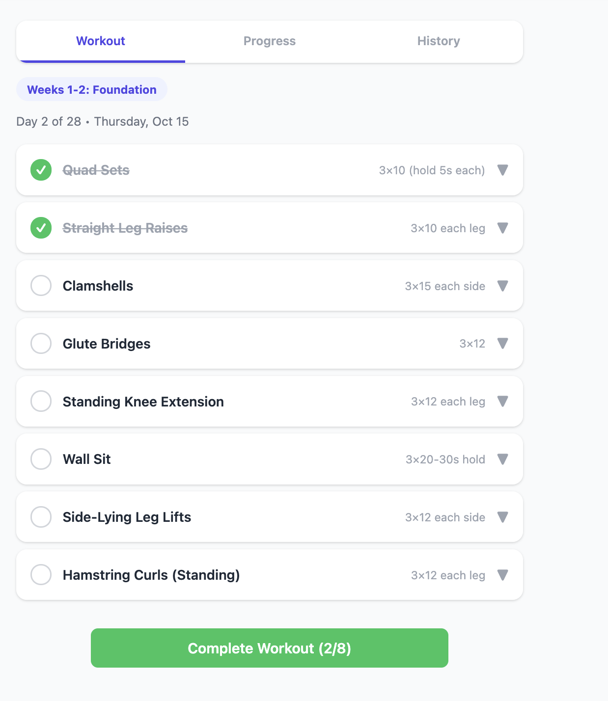

# ACL Leg Strength Tracker

A small web app for following a 4-week, band-based leg strengthening program after an ACL injury. It tracks daily workouts, measurements and progress, and syncs across devices through Google sign-in.

Live app: https://and.github.io/exercise/

> **Medical note:** this is a personal tracker, not medical advice. Get clearance from your surgeon or physical therapist before starting. See [`acl_resistance_band_guide.md`](acl_resistance_band_guide.md) for the full guide.

## Features

- **28-day program** in two phases: Weeks 1-2 Foundation and Weeks 3-4 Progression.
- **Per-exercise tracking** with set buttons, a cue for each exercise, an animation and a video link.
- **Rest timer** that starts when you finish a set (pause, skip, or add 15 seconds).
- **Manual day progression:** the day only advances when you complete a workout. It never advances just because the calendar day changes.
- **Complete Workout is locked** until every exercise for the day is done. The button shows your count, for example `Complete Workout (2/8)`.
- **Go back or restart from an earlier day:** use *Previous day*, or *Restart from day...* to pick any earlier day. Workouts logged for that day onward are deleted so you can redo them. Measurements are kept.
- **Progress tab:** workouts this week and measurement charts (thigh circumference, balance and wall sit, pain and knee confidence).
- **History tab:** past workouts, plus a **Reset progress** button that returns you to Day 1 (with the option to also delete measurements).

## How day progression works

| Action | Effect |
| --- | --- |
| Tick exercises | Kept on the page only. They reset if you reload before finishing. |
| Complete Workout (all exercises done) | Saves the workout and moves to the next day. |
| Previous day / Restart from day N | Deletes workouts for day N onward and sets the current day to N. |
| Reset progress | Deletes all workout history and returns to Day 1. |

The current day is stored in Firestore at `users/<uid>/profile/settings` as `currentDay`.

## Project layout

| File | Purpose |
| --- | --- |
| `index.html` | The whole app (HTML, CSS and JavaScript). |
| `firestore.rules` | Each user can read and write only their own data under `users/<uid>`. |
| `firestore.indexes.json` | Firestore indexes. |
| `firebase.json`, `.firebaserc` | Firebase hosting and Firestore configuration. |
| `leg_strength_checklist.md` | Printable daily checklist. |
| `acl_resistance_band_guide.md` | Background guide to the program and its safety notes. |
| `docs/` | Images used in this README. |

## Running your own copy

1. Create a project at [console.firebase.google.com](https://console.firebase.google.com) and add a web app.
2. Enable **Authentication → Google** sign-in.
3. Create a **Firestore** database and deploy `firestore.rules`.
4. Put your `firebaseConfig` values in `index.html` (search for `firebaseConfig`).
5. Serve the folder with any static host (GitHub Pages, Firebase Hosting, or `python3 -m http.server`).
6. If you serve it from a custom domain, add that domain under **Authentication → Settings → Authorized domains**.

## Data stored per user

- `workouts/<date>` for completed days (`day`, `phase`, exercises and sets, `completedAt`). A second day finished on the same date is saved as `<date>_d<day>`.
- `measurements/<date>` for thigh circumference, balance, wall sit, pain and confidence.
- `profile/settings` for `currentDay`.
